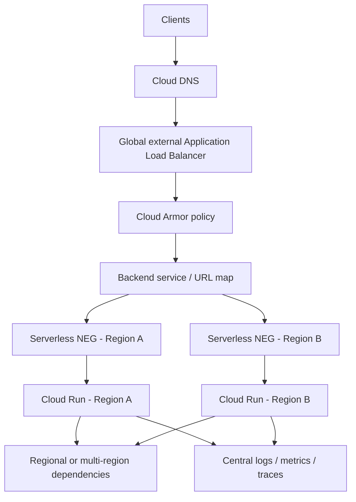

# Two-region Cloud Run HA design (target architecture)

## Routing and failover
Use a global external Application Load Balancer as the entry point, Cloud Armor for WAF/rate controls, and one serverless NEG per Cloud Run region. Configure backend traffic/failover according to the supported serverless NEG/load-balancing capabilities. Do not assume VM-style health checks are available for serverless NEGs. Detect regional impairment using synthetic probes, regional error/latency telemetry, and supported backend signals. Route away from the impaired region using the configured traffic-management mechanism.

Recovery: restore the region, deploy/confirm the same approved image digest and compatible config, run regional smoke tests, then gradually restore traffic. Failback should require a stable observation window and operator approval, not happen blindly.

## Dependencies that affect HA
Cloud Run is stateless, but the service is not highly available if it depends on a single-region database/cache, a single-region external API, a non-replicated secret/key, or a single queue/registry/control-plane dependency. Review Cloud SQL regional HA and cross-region promotion, Memorystore, Cloud Storage location/replication, Pub/Sub idempotency and DLQs, third-party quotas/timeouts, DNS/certificates, Secret Manager, KMS, and artifact availability.

## Initial targets (assumptions, not measured claims)
- Stateless request serving regional failover RTO: 5–15 minutes, depending on detection and routing automation.
- Stateless config RPO: effectively zero only when the same versioned config and image digest are available in both regions.
- Data RPO is dependency-specific; asynchronous database replication has a non-zero potential loss window. Agree and test with the data owner.

Validate with regional game days: inject a regional failure, measure detection and traffic restoration, check data consistency and duplicate processing, and record measured RTO/RPO.

## Identity, secrets, observability, rollback, cost
Use least-privilege runtime identities per region/environment; Secret Manager references with narrowly scoped accessor grants; replicated/available secrets and keys; centralized logs/metrics/traces with region, revision, digest, and trace IDs; same immutable image digest in both regions; rollback by routing to previous healthy revisions. Budget for minimum instances in both regions, load balancer, Cloud Armor, data replication, logging, and egress.

## Implemented vs conceptual
Implemented: single-region Cloud Run v2 service per Terraform environment, configurable region/image/identity/ingress/scaling/resources, secret references, and rollback guidance.
Conceptual only: global external ALB, Cloud Armor, two serverless NEGs, regional failover automation, DNS/certificates, cross-region data replication, and game-day validation. These need additional Terraform and a real GCP environment.
